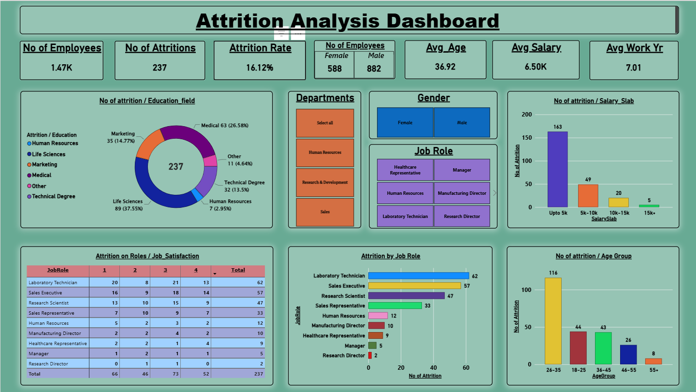

# Employee Attrition Analysis Dashboard

## Project Overview
This project analyzes employee attrition using an interactive Power BI dashboard. It helps explore workforce turnover patterns across departments, job roles, salary ranges, age groups, education fields, and job satisfaction levels.

## Dashboard Preview


## Key Performance Indicators (KPIs)
- **Total Employees:** 1.47K
- **Total Attritions:** 237
- **Attrition Rate:** 16.12%
- **Female Employees:** 588
- **Male Employees:** 882
- **Average Age:** 36.92 years
- **Average Salary:** 6.50K
- **Average Work Experience:** 7.01 years


## Dashboard Features
1. **Employee Overview:** Displays employee count, attrition count, and attrition rate.
2. **Education Field Analysis:** Examines attrition across different education backgrounds.
3. **Department Filtering:** Allows analysis by department.
4. **Gender Analysis:** Compares female and male employees.
5. **Salary Slab Analysis:** Shows attrition across salary ranges.
6. **Job Satisfaction:** Compares satisfaction scores across job roles.
7. **Job Role Analysis:** Identifies roles with higher employee attrition.
8. **Age Group Analysis:** Compares attrition across age groups.

## Tools and Technologies
- Microsoft Power BI
- Data visualization
- Data analysis and business intelligence
- Data transformation and DAX

## Key Observations
- The displayed attrition rate is 16.12%.
- Laboratory Technicians and Sales Executives have the highest attrition counts among the listed job roles.
- The 26–35 age group has the highest attrition count in the displayed chart.
- The salary slab below 5K has the highest attrition count in the displayed salary analysis.
- Attrition varies across education fields and job satisfaction levels.


## Repository Structure
```text
employee-attrition-analysis/
├── dashboard/
│   └── Employee_Attrition_Analysis.pbix
├── images/
│   └── employee-attrition-dashboard.png
├── data/
├── README.md
└── .gitignore
```
## Author
Aryan Nayak
